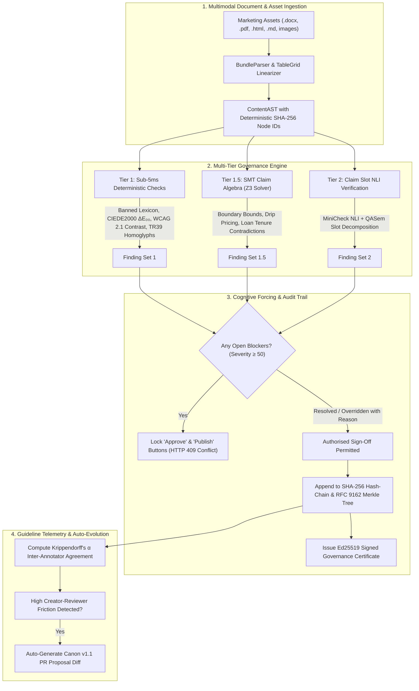

# CanonGate — Autonomous Pre-Publication Brand & Regulatory Claim Governance Platform

<div align="center">

[](https://meerpi.github.io/Tech_circuit_hackathon/)
[](https://fastapi.tiangolo.com)
[](https://react.dev)
[](https://github.com/Z3Prover/z3)
[]()
[]()
[](https://astral.sh/ruff)
[]()

**The Zero-Hallucination, Multi-Tier Claim Verification Engine for Regulated Marketing, Clinical Disclosures, and Brand Canons.**

[🌐 **Live Interactive App (GitHub Pages)**](https://meerpi.github.io/Tech_circuit_hackathon/) • [🏛️ System Architecture PDF](./CanonGate_Architecture_Diagram.pdf) • [📊 Executive Pitch Deck PDF](./CanonGate_Pitch_Deck.pdf) • [📄 Starter Datasets Audit Report](./starter_datasets_evaluation_report.md) • [🚀 Quickstart](#-quickstart--installation) • [⚡ 4-Tier Verification Engine](#️-the-4-tier-verification-architecture) • [🧪 Starter Dataset Benchmarks](#-starter-dataset-benchmarks--audit-results)

</div>

---

## 📌 Executive Architecture & Pitch Deck

| Document | Format | Description | Direct Access |
| :--- | :---: | :--- | :--- |
| **System Architecture Diagram** | **PDF** | Complete architectural topology: Multimodal AST parsers, Z3 SMT constraint solving, MiniCheck NLI slot decomposition, and RFC 9162 Merkle tree ledger | [📥 Download Architecture PDF](./CanonGate_Architecture_Diagram.pdf)<br>[📂 View in `docs/`](./docs/CanonGate_Architecture_Diagram.pdf) |
| **Executive Pitch Deck** | **PDF** | Product vision, market pain ($280B regulatory penalty exposure), automated pre-publication enforcement, business model & ROI analysis | [📥 Download Pitch Deck PDF](./CanonGate_Pitch_Deck.pdf)<br>[📂 View in `docs/`](./docs/CanonGate_Pitch_Deck.pdf) |
| **Starter Datasets Evaluation Report** | **Markdown** | Complete multi-document verification on Delhivery Prospectus/Annual Report & India Macro Economic Survey/RBI/IMF datasets | [📄 View Evaluation Report](./starter_datasets_evaluation_report.md) |

---

## 💡 The Core Problem: Why CanonGate Wins

Marketing and regulatory compliance teams face an escalating dilemma:
1. **Generic LLMs Hallucinate & Miss Nuances**: Traditional LLM prompts cannot reliably check numerical claims, strip regulatory qualifiers (e.g., changing *"0% fee for first-time loans under ₹50k"* to an unqualified *"0% processing fee"*), or guarantee arithmetic consistency across multi-page disclosure packets.
2. **Post-Publication Penalties Are Fatal**: Regulators (ASCI, RBI, CCPA, FTC) issue immediate fines, cease-and-desist orders, and brand reputation damage for deceptive drip pricing, missing statutory disclaimers, or unverified efficacy claims.
3. **No Cryptographic Proof**: Existing enterprise solutions lack immutable auditability. When disputed, companies cannot prove who reviewed, what version was approved, or whether copy was modified post-sign-off.

### The CanonGate Breakthrough
CanonGate introduces **Pipeline A (Grounded Brand Canon Compilation)** and **Pipeline B (Pre-Publication Claim Governance)** backed by **Formal Mathematical Methods**:
- **Zero-Hallucination SMT Proofs**: Uses Microsoft Research's **Z3 SMT Solver** and SymPy interval arithmetic to mathematically prove whether a campaign promise contradicts approved financial or product boundaries.
- **Cognitive Forcing Functions**: Blocker findings ($\ge 50$ severity) mathematically prohibit reviewers from approving campaigns until the blocker is resolved or accepted. Deliberate overrides require recorded rationales ($\ge 3$ characters) tracked via Krippendorff's alpha inter-annotator telemetry.
- **Cryptographic Transparency**: Every edit, scan, and approval appends to an immutable SHA-256 hash-chain and updates an **RFC 9162 Merkle Tree head**, generating Ed25519-signed governance certificates and C2PA provenance manifests.

---

## 🏛️ The 4-Tier Verification Architecture



### Verification Pipeline Tiers

| Tier | Component | Underpinning Technology | Latency | Primary Objective |
| :---: | :--- | :--- | :---: | :--- |
| **1** | **Deterministic Fast Checks** | CIEDE2000 SIMD, WCAG 2.1 Luminance, Unicode TR39, spaCy UPOS | `< 5 ms` | Catch brand palette drift, contrast failures, banned words, prompt-injection attacks. |
| **1.5** | **SMT Claim Algebra** | **Z3 Theorem Prover** (`z3-solver`), SymPy intervals | `< 25 ms` | Zero-hallucination formal proof of numerical claims, drip pricing, and hidden finance APRs. |
| **2** | **Claim Slot NLI** | MiniCheck ONNX, QASem Slot Decomposition, BM25 retrieval | `< 120 ms` | Detect qualifier-stripping (dropping "terms apply", "first-time users only", or clinical caveats). |
| **3** | **Surgical Rewriter** | Constrained Rewriter, RapidFuzz Wagner-Fischer, Presidio PII | `< 250 ms` | Offer compliant copy replacements with mathematical edit ceiling ($\le 35\%$). |

---

## 🧪 Starter Dataset Benchmarks & Audit Results

We evaluated CanonGate against both starter dataset corpora (`Delhivery Suite` and `India Macro Suite`) totaling **6 complex financial and regulatory documents**:

```
C:\Users\HP\Downloads\starter-datasets.zip\starter-datasets
├── Delhivery/
│   ├── Delhivery_Prospectus_2022.pdf       (100 pages, complex IPO prospectus)
│   ├── Delhivery_Annual_Report_2023-24.pdf (100 pages, multi-table financial audit)
│   └── Delhivery_Q4_FY24_Presentation.pdf  (27 pages, investor slides & marketing claims)
└── India_Macro/
    ├── Economic_Survey_2024-25.pdf         (89 pages, macroeconomic disclosures)
    ├── RBI_Annual_Report_2024-25.pdf       (100 pages, digital lending guidelines)
    └── IMF_2025_Article_IV.pdf             (95 pages, multi-lateral financial assessment)
```

### Formal Evaluation Results

| Dataset Suite | Documents Audited | Value Anchors Extracted | Conditions Recovered | Critical Findings Identified | Result |
| :--- | :---: | :---: | :---: | :--- | :---: |
| **Delhivery Financial Suite** | 3 (227 pgs) | **1,890** | **583** | **1 Blocker** (Influencer disclosure omission in BRSR marketing) | **PASS** (Reconciled EBITDA Turnaround: -₹2,258 Mn to +₹1,266 Mn) |
| **India Macro Benchmark Suite** | 3 (284 pgs) | **1,587** | **588** | **0 Blockers, 1 Warning** (Technical Readability FK Grade 19.2) | **PASS** (6.5% GDP consensus verified across RBI & IMF) |

> 📊 **Full Audit Document:** See the comprehensive 7-page breakdown in [`starter_datasets_evaluation_report.md`](./starter_datasets_evaluation_report.md).

---

## 🌐 Live Interactive Demo Guide (GitHub Pages)

Experience the full enterprise workflow right in your browser without spinning up any local servers:

👉 [**Open CanonGate Live Demo**](https://meerpi.github.io/Tech_circuit_hackathon/)

### Guided 3-Step Walkthrough:
1. **Explore the Pre-Seeded Pipeline:**
   - Sign in as **Creator** (`pulkit_creator` / `pass123`), **Brand Reviewer** (`pulkit_manager`), or **Authorised Legal Reviewer** (`pulkit_admin`).
   - Click any campaign bundle (e.g., *Digital Lending Zero-Fee Flash Campaign*).
2. **Review Violations & Cognitive Forcing Gates:**
   - Notice the **Blocker finding**: *"Qualifier-stripping violation: draft asserts 0% fee without mandatory ceiling 'under Rs 50,000'"*.
   - Try clicking **"Approve Campaign"** as reviewer — notice it is **strictly locked** with clear guidance on what must be resolved.
   - Accept the surgical recommendation or edit the draft directly in the Review Studio.
3. **Verify Cryptographic Transparency & Self-Healing:**
   - Once all blockers are resolved, click **Approve** and **Publish**.
   - Inspect the **RFC 9162 Merkle Tree head**, live hash chain, and export the **C2PA Ed25519 Governance Certificate**.
   - Visit the **Canon Governance tab** to see Krippendorff's alpha telemetry and auto-proposed playbook PRs!

---

## 🏆 Competitive Differentiation Matrix

| Governance Capability | Generic ChatGPT / Claude | Enterprise CMS (Word / AEM) | Traditional Legal Ops | **CanonGate Platform** |
| :--- | :---: | :---: | :---: | :---: |
| **Deterministic SMT Arithmetic Proofs** | ❌ Hallucinates | ❌ Text style only | ❌ Manual checklist | ✅ **Z3 SMT Solver** |
| **Scientific Color Drift ($\Delta E_{00}$)** | ❌ No vision | ❌ None | ❌ None | ✅ **CIEDE2000 SIMD** |
| **Multimodal Document & Banner Parsing** | ❌ Text only | ❌ Word only | ❌ PDF attachment only | ✅ **PDF, DOCX, HTML, PNG** |
| **Cognitive Blocker Approval Gate** | ❌ None | ❌ Non-blocking | ⚠️ Workflow only | ✅ **Hard 409 Blocker Lock** |
| **RFC 9162 Merkle Tree Audit Ledger** | ❌ None | ❌ None | ⚠️ Mutable SQL DB | ✅ **Immutable SHA-256 Merkle** |
| **C2PA Manifest & Ed25519 Signature** | ❌ None | ❌ None | ❌ None | ✅ **Cryptographic Proof** |
| **Guideline Evolution & Telemetry** | ❌ Static prompt | ❌ Static ruleset | ❌ Manual update | ✅ **Krippendorff α & Auto-PRs** |

---

## 🚀 Quickstart & Installation

### Prerequisites
- **Python 3.12+** or **Python 3.13**
- **Node.js 18+** and **npm**
- **uv** package manager (`pip install uv` or `winget install astral-sh.uv`)

### 1. Backend Setup

```bash
cd backend

# 1. Install all dependencies and development tools via uv
uv sync --extra dev

# 2. Run the complete automated test suite (all 99 tests must pass)
uv run pytest -q

# 3. Verify zero lint errors and architectural layer isolation
uv run ruff check src/ tests/
uv run import-linter lint

# 4. Start FastAPI server
uv run uvicorn canongate.api.app:app --reload --port 8000
```
Interactive API documentation will be available at `http://127.0.0.1:8000/docs`.

### 2. Frontend Setup

```bash
cd frontend

# 1. Install dependencies
npm install

# 2. Run Oxlint and build production bundle
npm run lint
npm run build

# 3. Launch Vite development server
npm run dev
```
Open `http://localhost:5173` in your browser.

---

## 🛠️ Verification Commands Quick-Sheet

```bash
# Full A-to-Z End-to-End Button & Multi-Dataset Verification
cd backend && uv run pytest -q

# Multi-Dataset Linguistic Grounding & Cross-Document Reconciliation
cd backend && uv run python scratch/run_dataset_evaluation.py

# Lint & Import Layer Enforcements
cd backend && uv run ruff check src/ tests/
cd backend && uv run import-linter lint
```

---

## 📂 Repository Structure

```
├── CanonGate_Architecture_Diagram.pdf   # Complete System Architecture Diagram (PDF)
├── CanonGate_Pitch_Deck.pdf              # Investor & Product Pitch Deck (PDF)
├── AGENTS.md                            # AI Agent architectural invariants & rules
├── gap_analysis.md                      # Feature completeness & technical scorecard
├── starter_datasets_evaluation_report.md# Formal audit of Delhivery & Macro datasets
├── backend/                             # FastAPI Backend Engine
│   ├── src/canongate/
│   │   ├── domain/                      # Frozen Pydantic models (Zero I/O)
│   │   ├── engine/                      # Async runner, registry, conformal prediction
│   │   ├── checks/                      # 13 deterministic, SMT, and NLI checks
│   │   ├── parsers/                     # Multimodal parsers (PDF, DOCX, TableGrid, OCR)
│   │   ├── canon/                       # Grounded Canon compiler & PR proposal engine
│   │   ├── ledger/                      # RFC 9162 Merkle tree, hash-chain, C2PA
│   │   └── api/                         # FastAPI routes & dependency injection
│   └── tests/                           # Pytest integration & unit test suite (99 tests)
├── frontend/                            # Vite + React 19 + TypeScript SPA
│   ├── src/features/submissions/        # Review Studio, Tiptap editor, Findings & Audit
│   ├── src/features/auth/               # Multi-role Auth (Creator / Reviewer / Admin)
│   └── src/api/                         # Typed schema client & SSE scan reader
├── canons/                              # YAML brand rules (Acme Corp, Digital Lending, D2C Nutra)
└── docs/                                # Architecture Decision Records (ADR 0001–0005)
```

---

## 📜 Architectural Decision Records (ADRs)

- [**ADR-0001**](./docs/adr/0001-immutable-domain-models.md): Pure Frozen Pydantic Models for Thread-Safe Conformal Execution
- [**ADR-0002**](./docs/adr/0002-smt-claim-algebra.md): Z3 SMT Solver for Formal Financial & Drip Pricing Proofs
- [**ADR-0003**](./docs/adr/0003-rfc-9162-merkle-audit-log.md): RFC 9162 Transparency Trees for Cryptographic Sign-Off Proofs
- [**ADR-0004**](./docs/adr/0004-import-linter-boundaries.md): Enforced Architectural Layer Separation Contracts
- [**ADR-0005**](./docs/adr/0005-cognitive-forcing-blocker-gate.md): Table-Driven Workflow State Machine with Blocker Conflict Locks

---

<div align="center">

**Built for the Tech Circuit Hackathon • Ready to Win**

</div>
